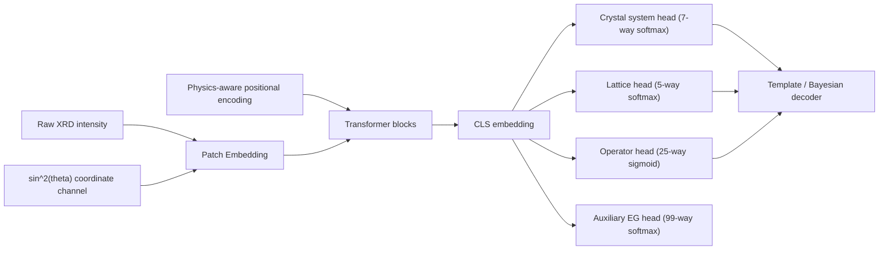
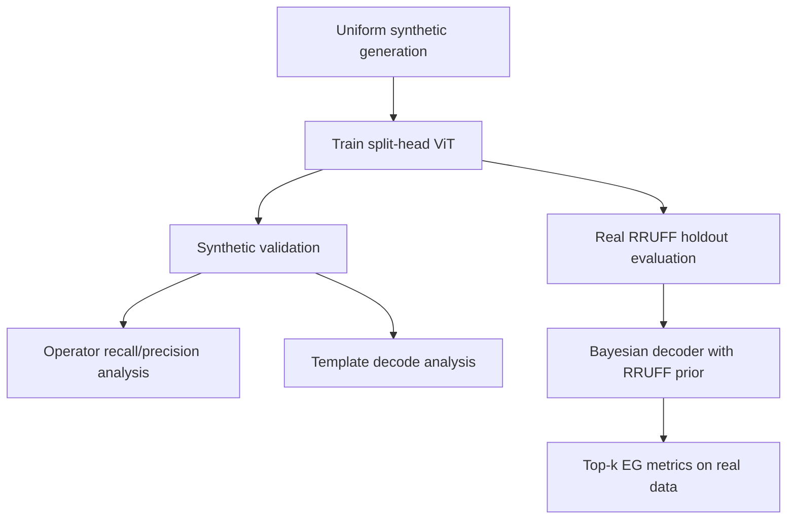

# Crystallographic ViT: Architecture Evolution, Rationale, and Results

Date: 2026-03-24

## Executive Summary

The project started from a standard extinction-group classifier and has progressively moved toward a model that encodes crystallographic structure explicitly.

The core trajectory has been:

1. Move from flat EG classification to a crystallographic multilabel representation.
2. Add a hybrid auxiliary EG head so the network still learns exact class separation.
3. Switch to a split head so mutually exclusive crystallographic quantities are modeled correctly.
4. Add physics-aware position information and an explicit coordinate channel so the model can better measure reciprocal-space geometry.
5. Add operator `pos_weight` to revive rare screw/glide bits that were collapsing to zero.

The net effect is that the model has become much more physically informed, but the bottleneck has shifted over time:

- first: **representation failure** on rare operator bits
- then: **metric-geometry weakness** on crystal-system/lattice prediction
- now: **calibration failure** on operator positives after aggressive `pos_weight`

## Why The Architecture Changed

### Initial Problem

A flat 99-way extinction-group classifier can succeed by memorizing class priors and dataset imbalance. That is useful, but it does not force the network to learn the crystallographic logic behind extinction rules.

We wanted the model to learn:

- crystal system
- Bravais lattice
- screw/glide/operator content

rather than only a categorical extinction-group index.

### Crystallographic Design Goal

We restructured the model so that the prediction task better reflects crystallographic hierarchy:

- crystal system is mutually exclusive
- lattice centering is mutually exclusive
- operator bits are not mutually exclusive
- extinction group is a canonical combination of the above

## Evolution Of The Model

### Stage 0: Flat EG Classification

Concept:

- one 99-way head
- learn extinction group directly

Problem:

- too easy to exploit geological priors
- no explicit pressure to learn crystallographic rule structure

### Stage 1: 37-Bit Multilabel Head

We replaced the flat target with a 37-dimensional crystallographic target:

- 7 crystal-system bits
- 5 lattice bits
- 25 operator bits

Each extinction group maps to a fixed 37-bit template.

This changed the task from “predict class id” to “predict crystallographic rule pattern”.

#### Rationale

- more physically meaningful supervision
- partial credit for nearly-correct crystallographic structure
- easier to interpret failure modes

#### Limitation

Pure BCE treats all 37 outputs as independent. That means the model can produce physically inconsistent mixtures, such as uncertainty across multiple crystal systems at once.

### Stage 2: Hybrid Model With Auxiliary EG Head

We kept the 37-bit head and added a 99-way auxiliary EG head.

The training objective became:

- multilabel BCE on the 37-bit crystallographic target
- plus auxiliary cross-entropy on the extinction-group id

#### Rationale

- preserve physically structured supervision
- add direct pressure for exact EG separation
- prevent the backbone from learning only a weak template approximation

#### Observation

This helped substantially. The auxiliary head consistently outperformed pure template decoding early in training, showing that the backbone could separate EGs better than the decoder was crediting it for.

### Stage 3: Split Head

We then replaced the single 37-bit BCE interpretation with a factorized head:

- `head_sys`: 7-way softmax
- `head_lat`: 5-way softmax
- `head_ops`: 25-way sigmoid/BCE
- `head_aux`: 99-way softmax auxiliary head

#### Rationale

This better matches crystallography:

- one crystal system
- one lattice centering
- multiple possible operator bits

This removed the worst “chimera” outputs from the first 12 dimensions.

### Stage 4: Physics-Aware Positional Encoding

We added positional information based on patch-center `sin^2(theta)` instead of relying only on abstract index position.

#### Rationale

In powder diffraction, reciprocal-space geometry matters. A standard ViT knows token order, but not physical spacing in scattering space. Physics-aware PE gives the transformer a more meaningful distance structure.

### Stage 5: Coordinate Channel

We then added a second input channel:

- channel 0: intensity
- channel 1: normalized `sin^2(theta)`

The patch embedding was changed from 1 input channel to 2 input channels.

#### Rationale

This gives the patch embedding an explicit physical ruler. The model no longer has to infer absolute reciprocal-space location solely through positional encoding.

#### Implementation Note

When converting from a 1-channel checkpoint to a 2-channel checkpoint:

- the old learned patch-embedding weights were copied into channel 0
- the new coordinate channel was zero-initialized
- optimizer state was dropped, because the input-layer parameter geometry changed

This preserved the learned intensity representation while allowing the coordinate feature to “thaw” gradually.

### Stage 6: Operator `pos_weight`

Validation analysis showed a severe rare-bit failure mode:

- many operator bits had high apparent accuracy
- but near-zero recall on positive cases
- the model was defaulting to all-zero predictions for rare operators

We added `pos_weight` to the 25-operator BCE term.

#### Rationale

Uniform sampling over extinction groups does **not** produce uniform operator marginals. Rare screw/glide bits are still rare, so BCE without weighting encouraged the model to predict zero almost always.

## Decoder Evolution

The decoder also evolved to better reflect both crystallographic structure and geological priors.

### Initial Decoder

- nearest template matching over all 99 canonical templates

### Improved Decoder

- Bernoulli log-likelihood scoring instead of flat Euclidean matching
- optional seen-class masking
- optional empirical class prior from the RRUFF distribution

The best real-data decoder so far has been:

- `split_bayes100_seen70`

That means:

- split-head template scoring
- seen-class restriction when appropriate
- Bayesian prior with weight 1.0 from the RRUFF training distribution

## Architecture Diagram

## Training / Evaluation Flow

## What We Observed

### RRUFF-Trained Hybrid Model

The RRUFF-trained hybrid model established the first meaningful real-data baseline.

Best real RRUFF holdout result:

- `bayes100_hier_seen70` top-1: `8.02%`

This was stronger on true experimental data than the later synthetic-only models, confirming that domain realism still matters.

### Early Uniform Synthetic Split-Head Pilots

Initial synthetic split-head pilot:

- train size: `371,623`
- synthetic test decode top-1: `1.02%`
- synthetic test aux top-1: `4.41%`

With physics-aware PE:

- decode top-1 stayed near `1.02%`
- aux top-1 improved to `6.65%`

With larger synthetic data (`1.16M` train):

- synthetic test decode top-1: `1.42%`
- synthetic test aux top-1: `11.29%`

With coordinate channel on `v4`:

- synthetic test decode top-1: `1.77%`
- synthetic test aux top-1: `13.03%`

Real RRUFF holdout for `v4`:

- best decoder (`split_bayes100_seen70`) top-1: `3.19%`

### Metric-Structure Measurements

On the synthetic validation split for `v4`, the split-head component accuracies were:

- crystal-system top-1: `48.85%`
- lattice top-1: `69.00%`
- operator bit accuracy: `93.66%`
- operator exact match: `13.65%`

Compared with the earlier baseline:

- system improved from `47.60%` to `48.85%`
- lattice improved from `68.62%` to `69.00%`

Interpretation:

- the model was still weak on metric structure
- operator bit accuracy was misleadingly high because most operator bits are zero

### Rare-Operator Failure Before `pos_weight`

The first operator breakdown showed that many operator bits had effectively zero recall, including bits such as:

- `Pos1_62`
- `Pos1_31`
- `Pos1_61`
- `Pos1_63`
- `Pos1_d`

This was a classic dead-bit problem.

### Effect Of `pos_weight`

The `v5` run added:

- lower LR
- warmup
- coordinate channel
- physics-aware PE
- operator `pos_weight`

The run timed out at epoch 7, but validation improved sharply:

- epoch 1 decode accuracy: `4.34%`
- epoch 7 decode accuracy: `4.98%`

Real RRUFF holdout with best decoder:

- `split_bayes100_seen70` top-1: `4.42%`

That is an improvement over the previous synthetic-only best of `3.19%`, though still below the `8.02%` RRUFF-trained baseline.

### Operator Breakdown After `pos_weight`

The dead-bit problem was cured.

Before:

- many operator bits had `0%` recall

After `pos_weight`, the weakest recalls were all above roughly `52%`.

Representative weak-but-alive bits:

- `Pos2_n`: recall `52.45%`, precision `22.33%`
- `Pos2_c`: recall `53.73%`, precision `31.12%`
- `Pos1_b`: recall `58.01%`, precision `18.10%`
- `Pos3_ab`: recall `58.33%`, precision `14.31%`
- `Pos1_42`: recall `64.38%`, precision `6.07%`
- `Pos1_21`: recall `65.82%`, precision `9.64%`

Interpretation:

- the model is no longer blind to rare positives
- the new problem is poor precision / over-firing
- we traded dead bits for over-sensitive bits

This is a much better failure mode than complete collapse, but it now calls for calibration work rather than recall rescue.

## Data Strategy Evolution

### Why We Moved Toward Uniform Synthetic Data

RRUFF is experimentally realistic, but it is not adequate as the only source for the crystallographic multilabel problem:

- it covers only 70 of 99 extinction groups
- some rule bits are missing
- operator marginals remain highly imbalanced

Uniform synthetic generation was introduced so that:

- all 99 extinction groups are represented
- rare operator rules are not absent from training
- the network is forced to learn crystallographic structure rather than only geological priors

### Generation Infrastructure

The synthetic generation pipeline now includes:

- paper-style augmentation
- impurity / second-phase mixing
- K-alpha splitting
- shard-based checkpoint/resume
- TACC-friendly per-shard process isolation for CFML stability

## Current Interpretation

The architecture is behaving sensibly.

The sequence of failure modes has been informative:

1. **dead rare bits**
2. **metric-structure weakness**
3. **over-sensitive operator positives**

This is not evidence that the crystallographic architecture failed. It is evidence that the model is learning the intended structure, and that each successive change exposed the next bottleneck more clearly.

## Current Plan

### Short-Term

1. Increase uniform synthetic training size by combining:
   - local TACC synthetic data
   - transferred Globus shards
2. Damp operator weighting from raw `neg/pos` toward `sqrt(neg/pos)`
3. Add decoder-side physical masking to suppress impossible operators under a predicted crystal system

### Medium-Term

1. Continue uniform synthetic pretraining on the larger merged dataset
2. Fine-tune on the large RRUFF dataset
3. Evaluate on the true RRUFF experimental holdout with the Bayesian decoder

## Decision Gates

### When To Try Focal Loss

Focal loss is **not** the next default step.

The correct sequence is:

1. revive dead rare bits with operator `pos_weight`
2. damp that weighting from raw `neg/pos` to `sqrt(neg/pos)`
3. re-measure operator recall/precision and downstream decode

We only move from weighted BCE to sigmoid focal loss if the following pattern remains true **after** the damped-weight run:

- rare-operator recall stays healthy
- operator precision is still poor
- exact-match and template decode are still being dragged down by false positives

Interpretation:

- **dead bits / low recall** -> weighted BCE is the right fix
- **over-firing / low precision after damped weighting** -> focal loss becomes justified

### When To Fine-Tune On RRUFF

RRUFF fine-tuning should come **after** the uniform-pretraining stage is clearly doing its job.

The gate is:

- system and lattice accuracy on synthetic validation are still improving or have stabilized at a useful level
- rare operator bits are no longer collapsed
- synthetic decode is no longer making large gains from simply adding more uniform data

Once that happens, the role of RRUFF is no longer to teach the crystallographic rules from scratch. Its role is to adapt the already-structured model to:

- real backgrounds
- real peak shapes
- mineral base rates
- experimental domain shift

So the intended sequence is:

1. uniform synthetic pretraining
2. calibration/loss refinement if needed (`sqrt(pos_weight)`, then focal loss only if necessary)
3. RRUFF fine-tuning
4. final real-data evaluation with the Bayesian decoder

## Current Status

As of 2026-03-24:

- `uniform2m_v2` generation is still running on Stampede3 `spr`
- landed Globus shards have been repacked to a train-ready file
- a merge job is combining:
  - current `v4` train-ready synthetic data
  - the repacked incoming Globus data

This merged synthetic dataset is intended to be the next larger Vista training input.
